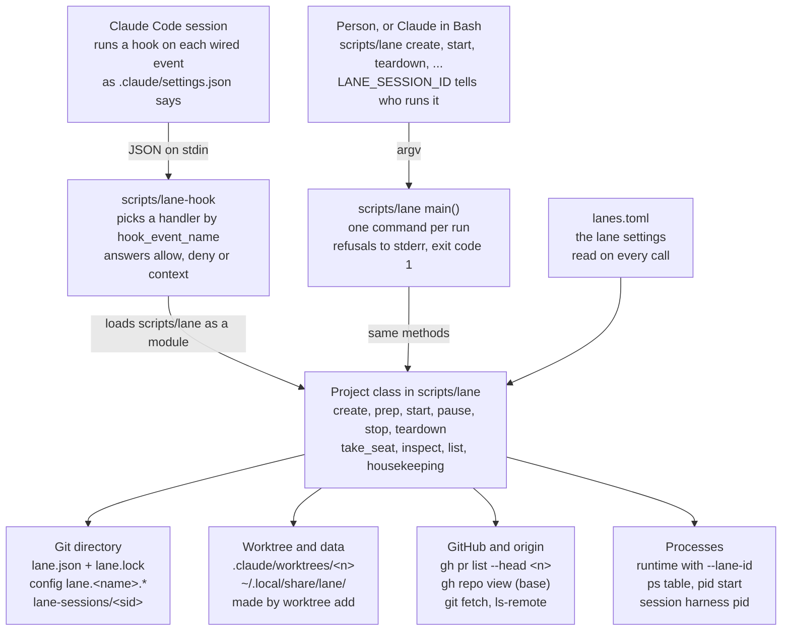
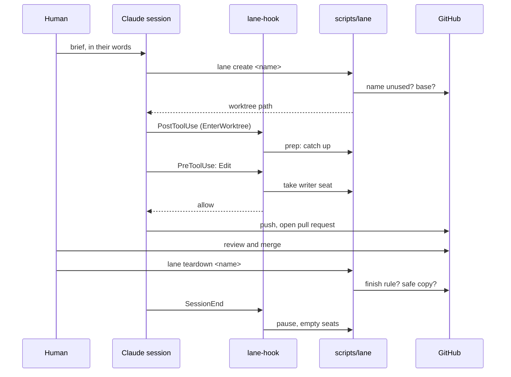
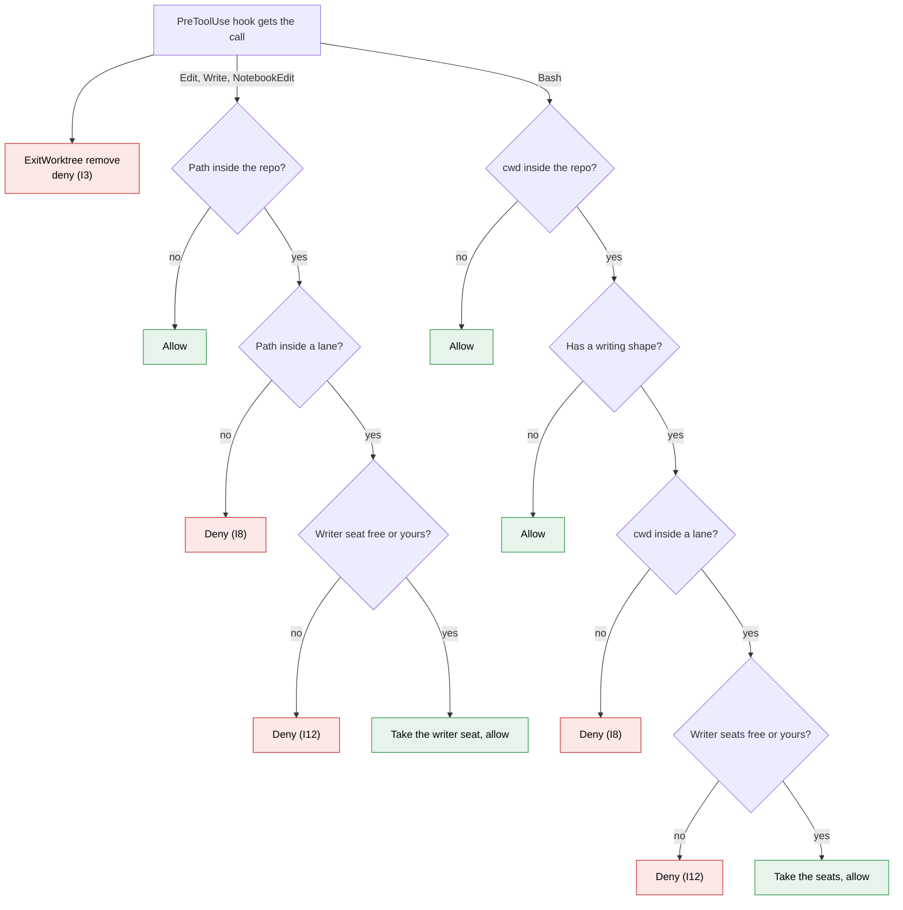
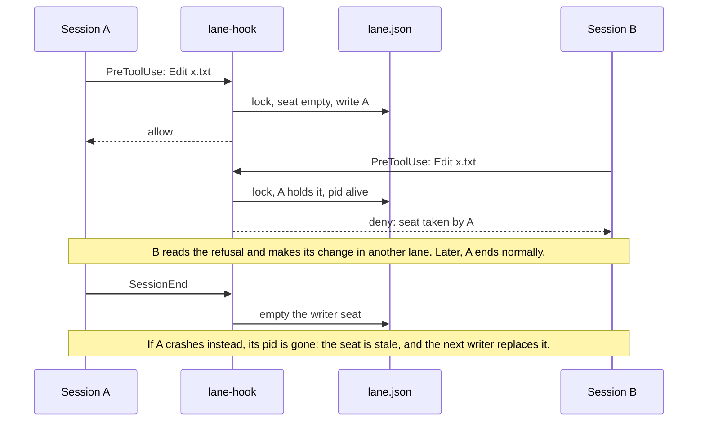
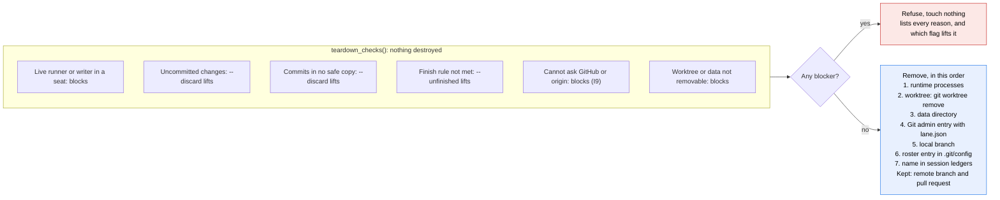

# How the lane model is built: hooks, seats and the lane tool

## Introduction

The lane model lets several Claude Code sessions work on one repository at the same time without touching each other's files, data or ports. This project implements it with four files: two Python scripts, one TOML file and one Claude Code settings file. It uses only the Python standard library, plus `git` and `gh`.

| File | Role |
| --- | --- |
| `scripts/lane` | The lane tool: every operation (create, prep, start, pause, stop, teardown, list, housekeeping) as one `Project` class and a CLI |
| `scripts/lane-hook` | The one hook entry point. Claude Code runs it, and it calls into `scripts/lane` |
| `lanes.toml` | The lane settings the model asks every project to declare |
| `.claude/settings.json` | Tells Claude Code which events run `scripts/lane-hook` |

The model is in `LANE-MODEL.md`. It does not mention Git or Claude Code; this implementation binds its terms to them. This document walks through the code, one model rule at a time, with excerpts and diagrams.

## Architecture

One code base serves two entry points. A person or Claude runs `scripts/lane <command>` from a shell. Claude Code runs `scripts/lane-hook` on each wired event. The hook does not copy the logic: it loads `scripts/lane` as a Python module and calls the same `Project` methods, with the same refusals.

```python
# scripts/lane-hook
here = Path(__file__).resolve().parent
spec = importlib.util.spec_from_loader("lane", SourceFileLoader("lane", str(here / "lane")))
lane = importlib.util.module_from_spec(spec)
spec.loader.exec_module(lane)

data = json.load(sys.stdin)
event = data.get("hook_event_name", "")
```

The last lines of the hook pick a handler by event name. A handler that raises `lane.Refuse` prints the reasons to stderr.

The tool keeps almost no records of its own. Everything it can derive, it derives: ids from the name, the runtime from the process table, the finish rule from GitHub. What it must write, it writes inside the repository's `.git` directory, never in the worktree's files, so nothing ends up in a commit.

| Record | Where | Why there |
| --- | --- | --- |
| Seats, starting point, port | `.git/worktrees/<entry>/lane.json`, guarded by `lane.lock` | Git's own admin directory for that worktree. It goes away with the worktree entry |
| Roster entry | `lane.<name>.created` in `.git/config` | Survives a deleted worktree, so the lane can still be traced and torn down (I6) |
| Session ledger | `.git/lane-sessions/<session id>` | Which lanes a session sat in, so `SessionEnd` knows what to pause |
| Prep note | `.git/lane-notes/<session id>` | `CwdChanged` cannot add context, so its prep result waits here for the session's next hook that can |
| Project id | Derived: `<slug>-<first 6 hex chars of sha1(main path)>` | Two clones of the same project never share data or lane ids |
| Lane id | Derived: `<project id>-lane-<name>` | Passed to the runtime as `--lane-id`, so every process can be traced back to its lane |

The diagram below shows who calls what.



Both entry points end in the same `Project` methods, so a refusal reads the same whether a hook or a shell command hit it.

## The settings that cross with the model

### `.claude/settings.json`: every event runs the main worktree's hook

All eight events run the same command. Only the `matcher` differs. Here is one entry; the others are the same apart from the event name:

```json
"PreToolUse": [
  {
    "matcher": "Edit|Write|NotebookEdit|Bash|ExitWorktree",
    "hooks": [
      {
        "type": "command",
        "command": "p=\"$CLAUDE_PROJECT_DIR\"; exec \"${p%%/.claude/worktrees/*}/scripts/lane-hook\"",
        "timeout": 60
      }
    ]
  }
]
```

The command looks odd, and it is the most important line in the file. `${p%%/.claude/worktrees/*}` is shell parameter expansion: it cuts the longest suffix that matches `/.claude/worktrees/*`. In a session working in a lane, `$CLAUDE_PROJECT_DIR` is `/repo/.claude/worktrees/fix-login`, and the expansion gives `/repo`. In the main worktree there is nothing to cut.

So every session, in any lane, runs the hook from the **main worktree**. A lane may edit its own copy of `scripts/lane-hook`, but that copy judges nothing until the change has landed in the main worktree. A lane cannot loosen the guard that watches it.

The other choices in the file:

- `PreToolUse` matches only the tools that write or remove: `Edit`, `Write`, `NotebookEdit`, `Bash` and `ExitWorktree`. Reads such as `Read` and `Grep` never start the hook.
- `PostToolUse` matches `*`, because any tool call proves the session is still alive and refreshes its heartbeat.
- `timeout` is 60 seconds because `create` and `prep` ask GitHub and fetch from `origin`.
- `.gitignore` lists `.claude/worktrees/`, so lanes are never seen as untracked files of the main worktree.

Two details of Claude Code's hook contract matter for this project:

- `$CLAUDE_PROJECT_DIR` is set for every hook command. It holds the session's project directory, which is the lane worktree when the session works in a lane.
- A `SessionStart` hook may append `export` lines to the file named by `$CLAUDE_ENV_FILE`. Claude Code then sets those variables for every Bash command of the session. This is how a plain `scripts/lane start` run by Claude knows which session runs it.

The events this project wires, and what the hook does on each:

| Event | Fires when | `scripts/lane-hook` does |
| --- | --- | --- |
| `SessionStart` | A session starts or resumes | Exports the session id and pid, reports every lane, preps the lane if the session starts inside one |
| `UserPromptSubmit` | The user sends a prompt | Refreshes the heartbeat of the seats this session holds, delivers a waiting prep note |
| `PreToolUse` (Edit, Write, NotebookEdit, Bash, ExitWorktree) | Before one of those tools runs | The main-worktree guard, takes the writer seat, refuses `ExitWorktree remove` |
| `PostToolUse` (every tool) | After any tool ran | Heartbeat. After `EnterWorktree`, preps the lane |
| `CwdChanged` | The session's working directory changes | Preps the lane it moved into and parks the result in a prep note |
| `WorktreeCreate` | Claude Code is about to create a worktree (`EnterWorktree` with a name, `claude --worktree`) | Replaces `git worktree add` with `lane create`. Refuses subagent worktrees |
| `WorktreeRemove` | Claude Code is about to remove a worktree | Runs `lane teardown`, with all its checks |
| `SessionEnd` | The session ends | Pauses the runtimes the session runs and empties its writer seats |

The `WorktreeCreate` and `WorktreeRemove` hooks replace Claude Code's own worktree handling. A `WorktreeCreate` hook must print the new worktree's path on stdout. Claude Code then switches the session into that path.

### `lanes.toml`: the model's lane settings

The model says a project declares its lane settings in a file next to its code. This is that file. `load_config()` reads it on every command and every hook call. It keeps no copy, so a change reaches every lane at once.

| Key | Model setting | Value here | What the code does with it |
| --- | --- | --- | --- |
| `[naming] pattern`, `min_length`, `max_length` | Naming rule | `[a-z0-9]+(-[a-z0-9]+)*`, 3 to 40 | `check_name()` refuses any other name at create |
| `[paths] worktrees` | Where lane worktrees live | `.claude/worktrees` | The same directory Claude Code uses for its own worktrees, so `EnterWorktree` and the lane tool agree |
| `[lane] runtime` | Runtime | `on-demand` | `start()` refuses when it is `never` |
| `[lane] runners` | Runners | person, script, session | `start()` refuses any other kind of runner |
| `[lane] safe_copy` | Safe copy | `remote-or-merged-pr-head` | Teardown checks commits against `origin` and merged pull request heads |
| `[lane] finish_rule` | Finish rule | `pull-request-merged-or-closed` | `finish_met()`: a pull request exists and none is open |
| `[runtime] command` | (implementation) | `python3 sample/server.py --lane-id {lane_id} ...` | Must carry `{lane_id}`, or the runtime could not be traced to its lane (I6) |
| `[seats] heartbeat_minutes` | (implementation) | 30 | A seat with no known pid goes stale after this |
| `[housekeeping] resting_days` | Housekeeping limit | 7 | Lanes with both seats empty longer than this are reported |

The tool refuses to run on a value it does not implement (I9). It does not fall back to a default:

```python
# scripts/lane, load_config()
for key, only in (("safe_copy", "remote-or-merged-pr-head"), ("finish_rule", "pull-request-merged-or-closed"),
                  ("pull_request", "required"), ("base", "pull-request-target")):
    if v[key] != only:
        problems.append(f"[lane]: {key} {v[key]!r} is not implemented by this tool")
```

The hook follows the same rule. When `lanes.toml` cannot be read, every guarded tool call (Edit, Write, NotebookEdit, Bash) made from inside the repository is denied. Nothing is allowed by default.

## The lane tool: create, prep, start, pause

A lane's life is create, prep, work, pull request, merge, teardown. The diagram at the end of this section shows one full run. This section shows the code for each step.

### Create: a name that was never used, anywhere

You can create a lane in two ways, and both end in `Project.create()`:

- Run `scripts/lane create fix-login-redirect`, then `EnterWorktree` with the printed path. This is the way `AGENTS.md` describes.
- Call `EnterWorktree` with a name. Claude Code fires `WorktreeCreate`, and the hook calls `create()` in place of `git worktree add`, then prints the path.

The name is checked against the naming rule, and then for any trace of an earlier lane with that name: a local branch, a directory, lane data, a roster entry. It is also checked on GitHub: a pull request or a branch on `origin`. That last check exists because teardown keeps the remote branch and the pull request. A new lane under an old name would inherit their finish rule and their commits.

```python
# scripts/lane, create()
try:
    base = self.repo_facts()["defaultBranchRef"]["name"]
    prs = self.prs(name)
except HostError as e:
    raise Refuse(f"{e}; the base and the name's uniqueness are never guessed (I6, I7, I9)")
```

When GitHub cannot be reached, create refuses: it does not guess (I9). When every check passes, it fetches the default branch, adds the worktree on a new branch from `origin/<base>`, and records the starting point (I7):

```python
# scripts/lane, create()
start = self.git("rev-parse", f"origin/{base}").stdout.strip()
a = self.git("worktree", "add", "--no-track", "-b", name, str(self.wt(name)), f"origin/{base}")
...
self.git("config", f"lane.{name}.created", now())
with self.record(name) as rec:
    rec.update({"name": name, "created": now(), "start": start,
                "start_base": base, "seats": {}, "idle_since": now()})
```

### Prep: warn, then catch up with the base

The model requires prep to warn whoever reaches a lane that runs under someone else (section 7.1). This implementation adds a catch-up with the base branch. Prep runs after create, on `resume`, and from three hooks: `SessionStart` in a lane, `CwdChanged` into a lane, and `PostToolUse` after `EnterWorktree`. The third exists because entering an existing worktree by path fires neither `WorktreeCreate` nor `CwdChanged`.

The base is the target of the lane's open pull request, or else the default branch. `sync()` returns one of five outcomes:

| Outcome | When |
| --- | --- |
| Current | The lane already contains the base, and `origin/<name>` is not ahead |
| Moved | The lane has no commits of its own, so it fast-forwards to the base |
| Merged | The repository does not allow rebase merges, so the base is merged into the lane |
| Replayed | The repository allows rebase merges, so the lane is rebased onto the base |
| Held | Anything that makes the catch-up unsafe: a merge in progress, uncommitted changes, a conflict, GitHub unreachable, or a live writer who is not you |

On a conflict, `sync()` aborts and resets to the commit it started from, so a held prep changes nothing. A catch-up changes the lane's files, so prep holds when another live writer sits in the seat (I12).

### Start, pause, stop

`start()` refuses unless the project allows a runtime and this kind of runner, the dependencies are on `PATH`, the lane is not Runaway, and no other live runner holds the seat. Then it gives the lane a port (kept in `lane.json`, so a resume gets the same one), creates the data directory, and launches the command from `lanes.toml`:

```python
# scripts/lane, start()
cmd = [a.format(lane_id=self.lane_id(name), port=port, data=data, worktree=wt) for a in self.cfg["runtime"]["command"]]
proc = subprocess.Popen(cmd, cwd=wt, stdout=log, stderr=log, stdin=subprocess.DEVNULL, start_new_session=True,
                        env={**os.environ, "LANE_ID": self.lane_id(name), "LANE_NAME": name})
```

`start_new_session=True` makes the runtime its own process group. Pause can then stop it and its children with one signal. The `--lane-id` in the command line is how `lane_procs()` finds the runtime later in `ps` output. The runner seat is written only after the port answers within 10 seconds.

- `pause` stops the processes and empties the runner seat. Data and port stay. Only the runner may pause.
- `stop` is for a Runaway lane: the runtime is up and no live runner is recorded. It refuses on a lane that is really Running, because nobody takes over a runtime (I5).



The arrows from the Claude session to the hook are events Claude Code sends; the dashed arrows are answers. Claude enters the printed path with `EnterWorktree`, which fires `PostToolUse` and preps the lane. Every later write passes through `PreToolUse` first, and `SessionEnd` leaves nothing running.

## The main-worktree guard (I8)

The guard is `pre_tool_use()` in `scripts/lane-hook`. It runs before every `Edit`, `Write`, `NotebookEdit`, `Bash` and `ExitWorktree` call, and returns one of three answers: deny, allow, or allow after taking the writer seat. The flow diagram at the end of this section shows the full decision.

### File tools decide by the target path

For `Edit`, `Write` and `NotebookEdit`, the guard knows exactly which file will change. It resolves symlinks first, so a link into the main worktree is caught too:

```python
# scripts/lane-hook, pre_tool_use()
parts = under(real(path), P.main)
if parts is None:
    return                          # outside the repository: not the guard's business
wparts = under(real(path), P.wtroot)
if wparts:
    me = session_actor(data["session_id"])
    try:
        fresh = P.take_seat(wparts[0], "writer", me)
    except lane.Refuse as e:
        deny("\n".join(e.reasons))
    if fresh:
        warn_writer(P, [wparts[0]], me)
    return                          # inside a lane: allowed once the seat is ours
deny("The main worktree is not a workspace (I8): make this change in a lane. ...")
```

The lane is the first path part under `.claude/worktrees/`. The write is allowed only if this session holds that lane's writer seat or can take it now. When the seat is freshly taken, the session has reached the lane in the model's sense (section 7.1), so `warn_writer()` adds a warning to Claude's context if the lane's runtime runs under someone else or under nobody.

### Bash decides by the working directory and the command's shape

A shell command has no target path to read. So the guard looks at two things: the `cwd` of the call, and whether the command text has a known writing shape. `shell_writes()` blanks out quoted text, so `grep 'a>b'` is not mistaken for a redirect. Then it splits the command on `&&`, `||`, `;`, `|` and newlines, and checks each segment:

| Shape | Examples caught |
| --- | --- |
| Redirect to a file (not `/dev/null`) | `echo x > f`, `cmd >> log`, `cmd &> out` |
| Plain writers | `tee`, `mv`, `cp`, `rm`, `mkdir`, `touch`, `ln`, `chmod`, `dd`, `patch`, `wget` |
| In-place editors | `sed -i`, `perl -i`, `ruby -i` |
| Git subcommands that write | `commit`, `add`, `checkout`, `switch`, `reset`, `merge`, `rebase`, `stash`, `pull`, `branch`, `tag` and more, also after `-C <dir>` |
| Package managers | `npm install`, `pnpm add`, `pip install`, `brew upgrade`, `uv sync` |
| Downloads | `curl -o`, `curl -O` |

`scripts/lane` itself is never counted as a writer. The lane tool must stay usable from the main worktree: that is where `create`, `list` and `housekeeping` run.

With the shape known, the cwd decides:

- **cwd outside the repository:** allowed. The guard does not judge commands that run elsewhere.
- **cwd in the main worktree, writing shape:** denied with an I8 message.
- **cwd in a lane, writing shape:** the session takes the writer seat of that lane. It also takes the seat of every other lane that a path in the command names (`named_lanes()`), since the shape cannot tell where the write lands (I12). A taken seat means deny.
- **no writing shape:** allowed.

### What the guard cannot see

The model accepts partial enforcement only if the docs name the gaps. `AGENTS.md` lists them, and the agent is told to avoid them:

- an interpreter that writes: `python3 -c`, `node -e`, `bash -c`, or a script that writes
- `find -delete`, `xargs`, `eval`
- a `cd` into the main worktree from inside a lane, or an absolute path or `git -C <main>` into it
- a command whose working directory is outside the project
- any write a person makes in a terminal

A second layer covers part of this. Once a session has entered a worktree, Claude Code itself refuses file edits outside it. That check lives in the harness, so the project cannot turn it off.



For Bash, "seats" means the lane of the working directory plus every lane a path in the command names. A deny reaches Claude as text, which it reads before its next step.

## Seats: one runner and one writer per lane (I12)

A seat is a small JSON object in the lane's `lane.json`. It records who sits there, since when, and how to tell whether they are still alive. A seat taken by a Claude Code session looks like this (the times are examples):

```json
"writer": {
  "kind": "session", "label": "8a770e4b",
  "session_id": "8a770e4b-f2f6-4f4a-beaf-b13f694aad14",
  "pid": 74826, "pid_start": "Fri Oct 9 09:12:03 2026",
  "since": "2026-10-09T12:15:40Z", "heartbeat": "2026-10-09T12:31:02Z"
}
```

### Taking a seat

`take_seat()` opens the record under an exclusive `flock` on `lane.lock`, so two sessions that write at the same moment cannot both win. If the seat holds someone else who is still alive, it refuses. If the seat holds you, or a stale occupant, it writes you in and reports whether you were already sitting there.

```python
# scripts/lane, take_seat()
with self.record(name) as rec:
    cur = rec.setdefault("seats", {}).get(seat)
    if cur and not same_actor(cur, actor):
        alive, _ = self.seat_alive(cur)
        if alive:
            raise Refuse([f"the {seat} seat of {name} is taken by {self.fmt_seat(cur)}",
                          "a taken seat stays with whoever sits in it; make the change in another lane (section 7.1)"])
```

The agent never needs to run `lane write`. The `PreToolUse` hook takes the writer seat on the first Edit, Write or writing Bash command in the lane. If the seat is taken, the hook denies the call, and Claude reads the refusal text. The rule in `AGENTS.md` ("a refusal stands") tells it to make the change in another lane, never to work around it. The sequence diagram at the end of this section shows two sessions meeting in one lane.

### Same actor, alive or stale

Two sessions are the same actor when their `session_id` matches. A person or a script matches by label. A seat is alive when:

| Occupant | Alive while | Why |
| --- | --- | --- |
| Person | Always, until they pause or release | The model says a person is never gone: they leave a seat only by their own step |
| Session or script with a known pid | The pid exists and its start time matches | The start time catches a pid the OS gave to a new process |
| Session with no known pid | A heartbeat less than 30 minutes old | The fallback when the harness process cannot be found |

### Finding the session's process

A hook runs as a short-lived child process, so its own pid says nothing about the session. `session_process()` finds the long-lived Claude Code process in two ways. Both rely on details Claude Code does not document. First it reads the harness's session records in `~/.claude/sessions/*.json` (or `$CLAUDE_CONFIG_DIR/sessions`). If that fails, it walks up the process tree looking for an ancestor whose command line holds the session id. When both fail, liveness rests on heartbeats alone. The session-start report says which way was used: "harness pid 74826 found via harness session record".

### Heartbeat and the session ledger

Every `UserPromptSubmit` and `PostToolUse` refreshes the heartbeat of each seat the session holds, at most once a minute per seat. To know which lanes to touch without scanning them all, `take_seat()` and `start()` append the lane name to a per-session ledger, `.git/lane-sessions/<session id>`.



The lock makes the read and the write of the seat one step, so two sessions writing at the same moment cannot both win. A stale seat needs no cleanup: the next writer takes it over.

## Session start and session end

### SessionStart: tell the session who it is, and what it walks into

`session_start()` does three jobs.

First, it writes the session's identity to `$CLAUDE_ENV_FILE`:

```python
# scripts/lane-hook, session_start()
envfile = os.environ.get("CLAUDE_ENV_FILE")
if envfile:
    with open(envfile, "a") as f:
        f.write(f"export LANE_SESSION_ID='{sid}'\n")
        if found:
            f.write(f"export LANE_SESSION_PID='{found[0]}'\nexport LANE_SESSION_PID_START='{found[1]}'\n")
```

This is the glue between the hooks and the CLI. When Claude later runs `scripts/lane start fix-login` through Bash, `actor_from_env()` finds `LANE_SESSION_ID` and records the **session** as the runner, not the person logged in to the machine. That is what lets `SessionEnd` pause exactly the runtimes this session started, and nothing else (I5).

Second, it lists every lane with its state and seats. Third, if the session starts inside a lane, it preps that lane. All of this goes back as `additionalContext`, so Claude starts the conversation knowing the rules. A session starts with:

```
Lanes are on in this project: the main worktree is read-only and every change is made in a lane. The method is in AGENTS.md.
Session 8a770e4b: harness pid 74826 found via harness session record.
- bash-takes-writer: Prepared, runner nobody, writer nobody
- confirm-worktree-remove: Prepared, runner nobody, writer nobody
...
```

### SessionEnd: leave nothing running

`session_end()` reads the session ledger and visits each lane in it:

- If this session holds the runner seat, it pauses the lane: the runtime stops, the data stays.
- If it holds the writer seat, it empties the seat.
- If the lane's worktree is gone, it tries a teardown, with every check. A refusal is printed, and the lane is left as it is.

Then it deletes the ledger and the prep note. A session that crashes never runs `SessionEnd`. Its seats then go stale: the pid is gone, or the heartbeat ages past 30 minutes. `lane list` shows such a lane as Runaway or as having a stale seat, and names the fix (I10).

### Subagents and worktree removal

Two more hooks protect the model from Claude Code's own worktree features:

- `worktree_create()` refuses a worktree requested by a subagent (`agent_id` is set, or the name starts with `agent-`). The model says a lane comes from a human brief and a name a person recognises. Subagents work inside their parent's lane and share its seats.
- `ExitWorktree` with `action: "remove"` is denied in `PreToolUse`, and a `WorktreeRemove` event runs `teardown()` with all its checks. Only teardown removes a lane (I3).

## Teardown and housekeeping

Teardown is split in two on purpose. `teardown_checks()` runs every check and destroys nothing. `teardown()` destroys only if the checks returned no blocker (I2). The flow diagram below shows the checks and the removal order.

Each check adds its finding to one of two lists. `block` holds refusals. `lifted` holds refusals the human chose to lift with a flag:

| Check | Can the human's word lift it? |
| --- | --- |
| A live runner or writer sits in a seat | No. The occupant must leave first |
| Uncommitted changes in the worktree | Yes, `--discard` (I1) |
| Local commits on no remote branch and in no merged pull request head | Yes, `--discard` (I1) |
| `origin` cannot be fetched, or GitHub cannot be asked, while unsafe commits exist | No. Nothing guesses (I9) |
| Finish rule not met: no pull request, or one still open | Yes, `--unfinished` (I4) |
| The worktree or data directory cannot be deleted (permissions) | No. Fix the permissions first |

The safe-copy check is the subtle one. A squash merge leaves the lane's own commits on no branch of `origin`. So for each merged pull request the tool fetches `refs/pull/<n>/head` and accepts commits that are in that head:

```python
# scripts/lane, teardown_checks(), host error handling left out
ahead = self.git("rev-list", name, "--not", "--remotes=origin").stdout.split()
if ahead:
    heads = []
    for p in self.prs(name):
        if p["state"] == "MERGED":
            fr = self.git("fetch", "origin", f"refs/pull/{p['number']}/head")
            if fr.returncode == 0:
                heads.append(p["headRefOid"])
    left = self.git("rev-list", name, "--not", "--remotes=origin", *heads).stdout.split() if heads else ahead
```

The last check exists because `shutil.rmtree` stops halfway on a directory it cannot empty. That would leave a lane half removed after the destruction had begun. `unremovable()` walks the tree first and reports the first such directory.

When nothing blocks, teardown removes, in this order: the runtime processes, the worktree (`git worktree remove --force --force`), the data directory, the worktree's Git admin entry with its `lane.json`, the local branch, the roster section in `.git/config`, and the lane's name in every session ledger (I13). It keeps the remote branch and the pull request on GitHub, because they are history, not lane state.

`AGENTS.md` tells the agent never to pass `--discard` or `--unfinished` unprompted. Only the human gives that word, for one lane at a time.



A flag only moves a finding from the blocking list to the lifted list. A live seat, an unreachable host and a directory that cannot be removed have no flag.

### Housekeeping

`housekeeping()` is a loop over every lane name the tool can find. It calls the same `teardown()` on each lane whose finish rule is met. A refusal goes into the report, with nothing lifted (I11). It also reports every anomaly from `inspect()`, and every lane whose seats have both been empty for longer than `resting_days`. It never passes a flag. It has no more power than the person who runs it.

## Testing a hook without Claude Code

A hook is a program that reads JSON on stdin and writes JSON on stdout. So you can test it without Claude Code: feed it the JSON, then read its answer. That is all `tests/test_hook.py` does:

```python
# tests/test_hook.py
def hook(self, event, cwd=None, extra_env=None, **fields):
    data = {"hook_event_name": event, "session_id": fields.pop("sid", "sess-aaaa-1111"), "cwd": str(cwd or self.main), **fields}
    p = subprocess.run([sys.executable, str(self.main / "scripts" / "lane-hook")], input=json.dumps(data), text=True,
                       capture_output=True, env={**self.env, **(extra_env or {})}, cwd=cwd or self.main)
    return p
```

A test then reads `permissionDecision` from the output. For example, two different session ids write the same lane file, and the second one must get `deny` with the first session's label in the reason.

The 63 tests (`python3 -m unittest discover tests`) need no network and no GitHub account. Each test builds a fresh world in a temporary directory:

- a bare repository `remote.git` that plays `origin`
- a project clone with a copy of `scripts/`, `sample/` and `lanes.toml`
- `tests/fake-gh` on `PATH` as `gh`. It answers `gh pr list --head <name>` from `prs-<name>.json` and `gh repo view` from `repo.json`. When a file named `DOWN` exists, it fails the way an unreachable GitHub fails, so the tests can check the I9 refusals
- `HOME` and `LANE_DATA_ROOT` inside the temporary directory, so no real lane data is touched

To see what Claude Code really sends, set `LANE_HOOK_LOG=<file>` before you start a session. The hook then appends each input it receives as one JSON line.

## Where each model rule lives

Every invariant of the model is enforced in one or two named places. When you change one, start there.

| Invariant | Enforced by | Where |
| --- | --- | --- |
| I1 Work is never lost silently | Safe-copy check: uncommitted changes, commits on no remote and in no merged PR head | `teardown_checks()` in `scripts/lane` |
| I2 Every refusal before any destruction | Checks and destruction in separate functions | `teardown_checks()` then `teardown()` |
| I3 Only teardown removes a lane | Deny `ExitWorktree remove`. `WorktreeRemove` runs teardown. Leftovers stay visible | `pre_tool_use()`, `worktree_remove()` in `scripts/lane-hook` |
| I4 A lane lives until its finish rule | `finish_met()` against GitHub pull requests | `finish_met()` in `scripts/lane` |
| I5 Nothing runs without a reason | Runtime only through `start()`. `SessionEnd` pauses. `stop` only for Runaway | `start()`, `stop()` in `scripts/lane`; `session_end()` in `scripts/lane-hook` |
| I6 Identity is total and reversible | Ids derived from the name. `--lane-id` on the runtime. Roster in `.git/config`. Name reuse refused | `lane_id()`, `names()`, `create()` |
| I7 The starting point is explicit | `start` and `start_base` written at create | `create()` |
| I8 The main worktree is not a workspace | `PreToolUse` guard on file tools and Bash shapes. Holes listed in `AGENTS.md` | `pre_tool_use()`, `shell_writes()` |
| I9 When a check cannot be made, nothing guesses | `Refuse` on an unreadable `lanes.toml`, an unknown setting or an unreachable host | `load_config()`, `HostError` handling |
| I10 Every Leftover and anomaly is visible | `inspect()` notes, each with its fix, printed by `lane list` | `inspect()`, `cmd_list()` |
| I11 Housekeeping has no extra power | Calls the same `teardown()`, never with a flag | `housekeeping()` |
| I12 One runner and one writer, stale seats recoverable | `take_seat()` under `flock`. `seat_alive()` by pid and start time, or heartbeat | `seat_alive()`, `take_seat()` |
| I13 Teardown removes everything the lane owns | Removal list in `teardown()` | `teardown()` |

A good reading order for the code: `lanes.toml`, then `.claude/settings.json`, then `scripts/lane-hook` from the bottom up (the handler table first), then `Project` in `scripts/lane` in file order. To adopt the tool in another project, copy `scripts/lane`, `scripts/lane-hook` and `lanes.toml`. Then edit the slug, naming rule and runtime command, and add the hook entries to that project's `.claude/settings.json`.
