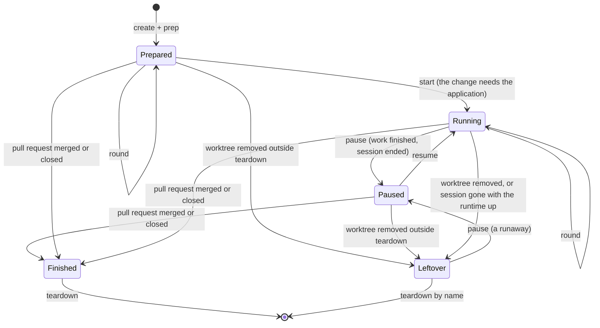

# The lane model

Draft, 2026-09-29. Meant to become the source of truth for lanes in every repository that uses them. It says what a lane is and what must always hold. It is built on two hard dependencies, Git and a web-based Git host with pull requests (section 8), and is independent of everything else: which host it is, the agent harness, the runtime, and the scripts a repository uses. Each repository's workflow docs and lane tooling are an implementation of this model and are checked against it, never the other way round. Appendix A binds the model's terms to each repository's tools; Appendix B records where each repository stands.

## Why lanes exist

Lanes serve two purposes, and every rule below serves one of them.

**Isolation.** Several tasks, run by agents or people, progress at the same time without touching each other's files, branches, data or ports.

**Economy.** Nothing runs that nobody needs. A lane spends most of its life waiting: for review, for the next brief, for its pull request to land. Its runtime (servers, workers, local services) costs memory, CPU and ports while it runs, and a machine that keeps every lane running runs out of all three. So a lane runs only while a session is working in it and the change needs the running application, and it stops as soon as either stops being true. **This is what the Paused state is for:** it keeps everything that is costly to rebuild (data, port, dependencies, the worktree) so that resuming is quick, while nothing runs. Paused, or Prepared for a lane that never needed a runtime, is the state a lane rests in. Running is the exception, and it always has an owner.

## Why this document exists

The lane gap reviews keep coming back with new gaps. Each fix closed one path into a bad state and opened or exposed another: a harness removal hook that turned out never to fire was replaced by a cleanup at session end, which produced leftovers housekeeping cannot match; a fix that syncs stacked lanes with their own base falls back to the default base when the Git host cannot be reached, which is the rewrite the fix was meant to stop. The fixes were local because there was no statement of what the whole system must guarantee. This document is that statement. A gap is a broken invariant (section 6), and a fix is complete only when every transition into the affected state (section 5) respects it.

## 1. Terms

### The environment

- **Git.** The repository's version control. A lane is a Git worktree on its own branch; "commit", "branch", "worktree", "remote" and "contains" mean what they mean in Git.
- **Git host.** The web-based service that holds the repository's remote (`origin`), its pull requests and their state, reached over the network. It is the source of truth for everything about a pull request, including its target branch, which can change after the pull request is opened.
- **Pull request.** A request to land a branch on a target branch, reviewed and merged or closed on the Git host. Called a merge request on some hosts; the model means the same thing.
- **Landing method.** How the Git host lands a pull request on its base. There are three, and a repository may allow any combination of them; which ones it allows is read from the Git host, like everything else about pull requests.
  - **Squash:** the pull request's commits become one new commit on the base. The lane's own commits never reach the base.
  - **Merge commit:** the lane's commits reach the base as they are, joined by a merge commit.
  - **Rebase:** the lane's commits are replayed onto the base as new commits. The originals never reach the base, and the Git host may refuse a branch that contains merge commits.

  The landing methods decide two things: how a lane catches up with its base (section 5.1), and how teardown proves a finished lane's commits exist elsewhere (I1).
- **Agent harness.** The program the agent runs in. It creates and removes worktrees, marks them as in use, and may offer hooks that run on its actions and at the end of a session.
- **Lane tool.** The repository's own commands that implement the lane operations (prep, start, pause, list, teardown). How they are named and invoked is the repository's business.
- **Dependencies.** Everything outside the repository that the lane's runtime needs in order to start: a container engine, a database server, installed packages, network access.

### The model

- **Main checkout.** The repository's original worktree. It is the integration point: on the default branch, current with the remote, with no work of its own. It hosts the lane tool and its registry, and housekeeping runs from it. Nobody works in it.
- **Lane.** One unit of work: one task, one name, one branch, at most one open pull request, one worktree, and the runtime and data the task needs. A lane is born from a brief and dies after its pull request is merged or closed.
- **Lane name.** A few lowercase words joined by dashes, chosen from the brief. The name is the lane's identity; everything else the lane owns is derived from it (section 3).
- **Base.** The branch the lane's work is meant to land on. Once the lane has an open pull request, the base is that pull request's current target branch as the Git host reports it, read again every time it is needed and never kept locally: a human can retarget a pull request, and the Git host retargets a stacked one when its parent lands. Before the pull request exists, the base is the default branch.
- **Stacked lane.** A lane whose pull request targets another lane's branch instead of the default branch.
- **Catch-up.** Bringing a lane that has commits of its own up to date with its base. It is done in one of two ways, merge in or replay, and the landing methods the repository allows decide which (section 5.1).
- **Merge in.** A catch-up that adds one merge commit to the lane, with the base as the other parent. The lane's existing commits stay as they are.
- **Replay.** A catch-up that recreates the lane's own commits, one by one and in order, on top of the base, and moves the branch to the result. The original commits are left behind, so a replayed branch has a new history and a published one must be pushed with a push that refuses to overwrite commits it has not seen. In Git this is a rebase; the model says replay to keep it apart from the rebase landing method.
- **Published.** A lane whose branch has been pushed to the Git host. From then on, other people can see and add to it, so its history is rewritten only where section 5.1 requires it, and then only by a push that refuses to overwrite commits it has not seen.
- **Round.** One cycle of work in a lane that ends with a commit pushed to the lane's remote branch and a report to the human.
- **Runtime.** Everything that runs for the lane: application servers, background workers, local services, stubs, any other process.
- **Data.** Everything the lane stores outside Git: databases, object stores, generated configuration, working directories.
- **Pause.** Stop the runtime, keep everything else.
- **Teardown.** Remove the lane for good: runtime, data, worktree, local branch, registry entries. Never the remote branch or the pull request.
- **Leftover.** Any resource of a lane that outlives its purpose: data without a worktree (an orphan), a local branch without a worktree, a runtime with no live session (a runaway), a stale lock, a log file, a worktree entry whose directory is gone.
- **Lock.** A marker that a session is working in a lane. Set by the harness or the lane tool, honoured by teardown.
- **Session.** One agent conversation. A session works in at most one lane at a time.
- **Housekeeping.** A procedure, not a service: from the main checkout, find the lanes whose pull request is merged or closed and tear them down with the same command a human would use, pause the runaways, and report everything else. The model defines what it does, not when it runs. Running it by hand, at the start of a session or on a schedule is the choice of whoever uses the model, and so is setting that schedule up.

## 2. Actors

| Actor | Does | Never does |
|---|---|---|
| Human | Writes the brief, decides where work runs, authorises discarding work or ignoring pull request state, decides when housekeeping runs | Nothing is forbidden, but every override is an explicit word, not a default |
| Agent (in a session) | Creates the lane, starts its runtime only when the change needs it, works in rounds, pushes, opens the pull request, pauses the lane, tears down its own finished lanes, runs housekeeping when asked | Discards unpushed work, tears down a lane whose pull request is open or missing, edits the main checkout, leaves a runtime running that no session needs |
| Agent harness | Creates worktrees, marks them in use, offers to keep or remove them at session end, runs hooks | Knows nothing about runtime or data; its own removal is never trusted to be complete |
| Git host | Holds remote branches and pull requests, may delete a head branch on merge, keeps the merged head reachable | Knows nothing about local lanes |

Housekeeping is not an actor. It is run by the human or by an agent, whether by hand or from a schedule the user set up, and it has exactly the powers of whoever runs it and no more (I11).

Merging or closing a pull request is outside the model. Who may do it, and under which conditions (review, checks, a required approval), is the repository's review process, set on the Git host. The model only reacts to the result: a merged or closed pull request finishes the lane (I4), whoever did it.

## 3. What a lane owns

Every resource belongs to exactly one lane and is found from the lane name alone, or from a registry that the lane tool writes and reads. Resources fall into three classes, and the class decides how carefully a resource is removed.

| Class | Resources | Rule |
|---|---|---|
| Work (irreplaceable) | Uncommitted changes, commits that exist only locally | Destroyed only when it provably exists elsewhere (on a remote reference, or inside the head of a merged pull request) or when the human says to discard it |
| State (costly to rebuild) | Databases, object stores, loaded or seeded data, assigned network ports, installed dependencies | Kept while the lane is paused, which is what makes pausing cheap; destroyed only by teardown |
| Runtime (costly to keep) | Processes: servers, workers, local services, stubs | Runs only while a live session needs it; stopped by pause, which is always safe because nothing of value lives in a process |
| Disposable | Logs, generated configuration, caches, registry entries | Recreated on demand; removed by teardown |

State and runtime pull in opposite directions, and the Paused state is how the model gets both: keep what is slow to rebuild, stop what is expensive to keep.

Identity rules:

- Name → branch → worktree path → every resource id is a pure function of the name. Distinct names give distinct ids, including when a dependency shortens or rewrites the ids it is given.
- The reverse holds too: from any leftover (a data store, a process, a branch, a registry entry) the lane tool can name the lane it belonged to. A leftover that cannot be traced to a lane name cannot be cleaned up safely and becomes permanent.
- The lane's local branch, its remote branch and its pull request head carry the same name. A lane that pushes to a branch of another name breaks identity: nothing that looks up the pull request by name will find it.

## 4. States

- **Prepared.** Worktree and branch exist, synced with the base. No runtime, no data. Enough for changes to docs, scripts and agent files, and the resting state of a lane that never needs the application.
- **Running.** Runtime up. Always owned by exactly one live session, and only while the change needs the running application: to verify it, or for the human to look at it between rounds of that session. A lane that is running for no one is a runaway, not Running.
- **Paused.** Runtime stopped; data, port, dependencies and worktree kept. The resting state of every lane that has run: between sessions, after the pull request is opened, while waiting for review. Resuming from here costs seconds, not a rebuild.
- **Finished.** The pull request is merged or closed. The lane still exists, normally Paused or Prepared; it is waiting for teardown.
- **Leftover.** Something of the lane outlives its purpose: the worktree is gone but data, branch or registry entries are not, or the runtime is up with no live session (a runaway). Always an anomaly. It must be visible and recoverable, never silent: pause ends a runaway, teardown by name ends the rest.
- **Absent.** Nothing of the lane remains locally. The remote branch and the pull request are not the lane's to remove.

There is no state in which a lane holds irreplaceable work and nothing refuses its removal, and no resting state in which a lane has a runtime.

## 5. Transitions

Each transition has one trigger, one owner and a fixed set of checks. A new mechanism (a hook, a flag, a housekeeping step, a harness feature) either implements one of these rows or adds a row here first.

| Transition | Trigger | Owner | Checks before acting | When a check fails |
|---|---|---|---|---|
| Create | Human brief asking for a lane | Agent, through the harness | Name follows the naming rule; the worktree starts from the remote base, not from the main checkout's state | Stop, ask |
| Prep | Right after create; on every resume | Lane tool | No Git operation in progress (merge, rebase, cherry-pick, revert) | Stop, name the operation to finish or abort |
| Sync with base | Part of prep | Lane tool | Section 5.1 | Section 5.1 |
| Start runtime | The change needs the running application, and not before | Lane tool | Dependencies are available; no other session owns the lane | Stop, ask the human to provide the dependencies; never install or start them on the agent's own initiative |
| Round | Work done | Agent | Build and checks the repository requires | Report; push a broken round only when asked |
| Pause | Work finished; session ends; human asks; a runaway is found | Lane tool, session-end hook | The lane is owned by this session, or by no live session at all (a runaway) | Leave it running and say so |
| Resume | Follow-up round | Lane tool | Same as prep, then same as start | Same as prep and start |
| Open pull request | Work finished | Agent | Branch pushed; no pull request open for it yet | Report |
| Finish | The pull request is merged or closed on the Git host | Whoever the repository's review process allows; not the model's concern | Set by the review process, not here | — |
| Teardown | Lane finished; human asks | Whoever runs housekeeping, the agent or the human, all through one command | In this order, all before anything is destroyed: not locked by a live session; no uncommitted changes; every local commit on a remote or in a merged pull request head; pull request merged or closed | Refuse, touch nothing, name the reason and the override if one exists |
| Worktree removed outside teardown | Harness removal, manual deletion, `git worktree remove` | Anyone | Refused where the harness lets a hook refuse it | The lane becomes Leftover; the next list shows it; teardown by name recovers it with the same checks against the leftover branch |
| Session ends | Exit, logout, crash | Harness, session-end hook | — | On a clean end the hook pauses the lane; on a crash the runtime becomes a runaway and the lock goes stale, and both show in the list (I10, I12) |

### 5.1 Sync with base

Sync brings a lane up to date with its base, so the work is tested against the branch it will land on. It runs as part of prep, at create and at every resume. It never runs in the middle of a round.

#### Catch-up method

A lane with commits of its own catches up in one of two ways. The landing methods the repository allows decide which one. The lane tool picks the least destructive method that keeps every allowed landing method possible.

| Landing methods allowed | Catch-up | Why |
|---|---|---|
| Squash, merge commit, or both | **Merge the base in** | Nothing is rewritten. The lane tool never pushes over a published branch, and a reviewer's commits on it stay where they are. Under squash the catch-up merges disappear on landing. Under merge commit they become part of the base's history |
| Rebase, alone or with others | **Replay the lane onto the base** | A rebase landing needs a linear branch, and the Git host may refuse one with merge commits. Replaying rewrites the branch. A published lane is then pushed with a push that refuses to overwrite commits it has not seen |

A repository that does not want catch-up merges in its history turns off merge-commit landing. A repository that does not want its published branches rewritten turns off rebase landing. The repository makes this choice in the Git host's settings. The lane tool reads it from there on every sync, not from its own configuration.

#### Outcomes

Every run ends in exactly one outcome, reported in one line. Held changes nothing and names the one step that moves the lane forward.

| Situation | Outcome | What the lane tool does |
|---|---|---|
| The lane already contains its base and everything on its remote branch | **Current** | Nothing |
| The lane has no commits of its own | **Moved** | Moves the branch to the base. Uncommitted changes are kept |
| The lane has commits of its own and catches up by merge | **Merged** | Merges in the commits its remote branch has and the worktree lacks, then merges the base in. The next push is a plain push |
| The lane has commits of its own and catches up by replay | **Replayed** | Replays the lane's local commits onto its remote branch first, so no other person's commits are lost, then replays the lane onto the base. For a published lane, it says that the next push must refuse to overwrite commits it has not seen |
| The lane tool cannot reach the Git host (offline, not authenticated, client missing) | **Held** | Nothing. Names what is missing |
| A catch-up is needed and the worktree has uncommitted changes | **Held** | Nothing. Asks for a commit, and a work-in-progress commit is fine |
| The lane catches up by replay and has merge commits of its own | **Held** | Nothing, because a replay would flatten them. Names the two ways forward, a replay on the human's word (section 7) or landing the pull request by another method |
| The catch-up conflicts | **Held** | Restores the worktree as it was, lists the conflicting files and names the step to resolve them |

#### Rules

- On every run, sync asks the Git host for the base and for the allowed landing methods, and trusts no earlier answer. A pull request's target and the repository's settings can change at any time. Sync therefore needs the network. Without it the outcome is Held. Sync never falls back to the default branch, to a remembered base or to a default catch-up method (I7, I9).
- Sync never loses a commit. A merge catch-up cannot lose one. A replay first brings in whatever the remote branch has, and its push refuses to overwrite anything it has not seen.
- When a stacked lane's parent has landed, the Git host retargets the lane's pull request, and the parent's base becomes the lane's base. What happens next depends on how the parent landed.
  - **Parent landed by merge commit.** The parent's commits are now on the base, unchanged. Either catch-up applies without extra steps.
  - **Parent squashed or rebased, catch-up by merge.** Merging the base in brings the parent's new commits. The lane already holds the same changes as the parent's original commits, so the merge is clean except where the parent changed after the lane branched from it.
  - **Parent squashed or rebased, catch-up by replay.** The lane still carries the parent's original commits, which no longer exist on the base. The lane tool reads the parent's merged head from the Git host and replays only the commits after it, which are the lane's own. No manual step is needed.

## 6. Invariants

These hold in every repository, whatever the tooling. Appendix B maps each one to the known gaps.

- **I1. Work is never lost silently.** Irreplaceable work is destroyed only when it provably exists elsewhere, or when the human explicitly says to discard it. "Provably" means a remote reference or a merged pull request head contains it, checked at the moment of removal. The two cover every landing method: after a merge commit the lane's commits are on the base itself; after a squash or a rebase they are on no branch at all once the Git host deletes the head branch, and only the merged pull request's head still contains them.
- **I2. Every refusal comes before any destruction.** Teardown evaluates all its checks first and then destroys; it never deletes data and then discovers it cannot remove the worktree.
- **I3. One way out.** Teardown is the only operation that removes a lane. Every other removal path is refused where it can be refused, and where it cannot (a harness prompt, a manual deletion) it leaves a Leftover that the same teardown recovers with the same checks.
- **I4. A lane lives as long as its pull request.** A lane is removed only after its pull request is merged or closed, and the teardown command enforces this itself; a rule that lives only in the docs is not enforced. Ignoring the pull request state is a human decision with its own override, separate from discarding work.
- **I5. Nothing runs without a reason.** A runtime starts only when the change needs the running application, never by default and never "in case". It belongs to exactly one live session, and it stops when that session ends or the work is finished, whichever comes first. Lanes rest Paused or Prepared. Nothing a session does at its end touches a lane another live session is using. A runtime with no live session is a runaway: it shows in the list, and anyone may pause it, since no session owns it.
- **I6. Identity is total and reversible.** Every resource id derives from the lane name without collisions, and every leftover maps back to a lane name.
- **I7. The base is explicit, and catching up never loses a commit.** A lane starts from the remote base. The base is whatever the Git host says the pull request targets now, and the catch-up method follows from the landing methods the Git host says the repository allows; no local copy of either is trusted. When the Git host cannot be asked, sync is Held (section 5.1); it never falls back to a different base or method. A published branch is rewritten only when a rebase landing requires it, after the remote branch's commits are brought in, and only by a push that refuses to overwrite commits it has not seen.
- **I8. The main checkout is not a workspace.** It is on the default branch and clean. Every change, including changes to the agent's own files, is made in a lane. Enforcement covers every way an agent writes files, not only some of them; where it is partial, the docs say which paths are uncovered. Read-only steps that run from the main checkout (listing lanes, reading pull request states) do not require it to be clean.
- **I9. Destroy fails closed, sync fails still.** When a check cannot be made, a destructive operation refuses and a non-destructive one does nothing. Neither guesses.
- **I10. Every leftover is visible and names its fix.** Listing lanes shows runaways, orphans, leftover branches, stale locks, worktree entries whose directory is gone and stray files, each with the command that clears it. When the list cannot see something (a dependency is down), it says so instead of showing nothing.
- **I11. Housekeeping has no more power than whoever runs it.** It uses the same commands with the same refusals, whether it runs by hand or from a schedule. It never adds an override on its own reading of the situation; a case the command refuses goes into its report.
- **I12. One session per lane, and locks are recoverable.** A lane is worked on by one session at a time, and the lock says which. A lock whose session is gone is detectable and clearable by an explicit step that first checks no process of that session remains; "end the session first" is not an answer when the session no longer exists.
- **I13. Teardown removes everything the lane owns.** Every resource that create, prep or start made is removed by teardown, or listed as a leftover when it cannot be (a dependency is down). A resource type added to create or start is added to teardown in the same change.

## 7. Overrides

There are exactly four, they are separate, and each belongs to the human.

| Override | Bypasses | Who may pass it |
|---|---|---|
| Discard work | I1: uncommitted changes and commits that exist nowhere else | The agent, only on the human's explicit word for that lane |
| Ignore pull request state | I4: an open pull request, none, or a lookup that failed | The agent, only on the human's explicit word for that lane |
| Flatten on replay | Section 5.1: a replay catch-up over the lane's own merge commits, which it flattens without losing their changes | The agent, only on the human's explicit word for that lane |
| Clear a stale lock | I12 | The human, or the agent on the human's word, after the lane tool has shown the owning session is gone |

No override bypasses I2, and housekeeping never passes one on its own.

## 8. What the environment must provide

### Hard dependencies

The model is not defined without these. A repository that lacks one does not use lanes.

| Dependency | Used for |
|---|---|
| Git, with worktrees | The lane itself: one worktree and one branch per lane; "contains" and "missing from every remote" for I1 |
| A web-based Git host, reachable over the network, with an API the lane tool can call | Pull request state for teardown (I4); the pull request's current target and the repository's allowed landing methods for sync (I7, section 5.1); merged pull request heads for I1 |
| The Git host keeps a merged pull request's head reachable after deleting its branch | I1 in a repository that allows squash or rebase: the only proof that a finished lane's commits exist elsewhere. A repository that allows only merge commits does not need it |

Because the Git host is a hard dependency, being unable to reach it is not a degraded mode with its own rules: every step that needs it refuses (teardown) or is Held (sync), and says the Git host could not be asked (I9).

### Capabilities that vary

Some invariants can only be enforced in code when the harness or the runtime offers a matching capability. When one is missing, the invariant does not go away: it falls back to the docs, and the lane tool must at least make the consequence visible (I10). Each repository's binding (Appendix A) says which of these it has.

| Capability | Needed by | Without it |
|---|---|---|
| Harness lets a hook refuse its worktree removal | I3 | Removal always produces Leftovers; list and teardown by name carry the whole burden |
| Harness signals the end of a session, with a reason and the working directory | I5 | Every session end leaves a runaway, to be paused by hand or by housekeeping |
| Harness or lane tool records which session holds a lane, and whether it is still alive | I5, I12 | Session-end cleanup cannot tell its own lane from another session's; runaways cannot be told from running lanes; stale locks need the human |
| The lane tool can find every process of a lane, not only the ones listening on its port | I5, I13 | Side processes survive pause and teardown; the list must say it cannot see them |
| Dependencies can be queried for what they hold, by lane id | I10, I13 | Orphans are invisible while the dependency is down; the list must say so |
| Dependencies accept any id the lane tool derives, or document how they shorten it | I6 | Long names collide; the lane tool must shorten ids itself, with a hash, and keep a registry |
| Hooks on every way the agent writes files | I8 | The main checkout rule is partly docs-only; the uncovered paths are named |

## 9. Every change to the lane tooling

A change to the lane tool, a hook, a setting, the housekeeping procedure or the use of a harness feature answers these before it is merged:

1. Which invariants does it enforce or rely on?
2. Which transitions (section 5) does it add, change or remove? Update the table in the same change.
3. For each transition into the states it touches, including the anomalous ones (Leftover, a runaway, a crashed session, the Git host unreachable, a second session in the same lane, a lane whose branch has another name), does every invariant still hold?
4. Can it leave anything running that no session needs (I5)?
5. What does it do when a tool it calls is missing or unreachable? It must satisfy I9.
6. What leftovers can it produce, and does the list show them with their fix (I10)?
7. Does housekeeping still find and tear down every lane it should, by the names it actually reads (I6, I11)?
8. Does it rely on a capability from section 8, and does the repository's binding say it has it?

A change that cannot answer one of these says so in its pull request, as an open gap with an id, instead of leaving it for the next review to discover.

## 10. Open questions for the human

These are decisions, not gaps. None is settled here.

1. **Review lanes.** Should a second lane on an existing pull request branch exist at all? If yes, I6 needs a registry that maps the lane to the branch it pushes to; if no, a follow-up always reuses the original lane, and a fresh one is created by the same name after teardown.
2. **One session per lane.** Is this a rule (I12 as written), or may a human open a second session in a lane that an agent is working in? The session-end behaviour depends on the answer.
3. **Lane data.** Is a lane's data always disposable at teardown, or does any repository keep data in lanes that must be exported first?
4. **Where this document lives.** One copy in a shared place that every repository's workflow docs point to, a copy in each repository kept in sync by a docs review, or a skill checked in to each repository.
5. **Repositories whose lanes are generated by an external package.** Do they adopt this model, which means changes upstream in that package, or stay out of scope?
6. **Stacked lanes before their pull request exists.** Since the base comes only from the Git host, a child lane without a pull request syncs with the default branch and would catch up with it, which later shows up in its pull request's diff against the parent. Three ways out: the child opens a draft pull request against the parent at its first push, so the Git host holds the base from the start (this bends the rule that a pull request is opened once, when the work is finished); sync is Held for a lane that was created from a branch other than the default one and has no pull request yet; or stacked lanes are created only once the parent has landed.
7. **Idle runtime.** Should a lane that is Running but untouched for a long time inside a live session also pause on its own, or is the end of the session the only automatic pause?

## Appendix A. Bindings

Each repository fills in its rows; apart from Git, the model's text never names these tools. A binding is part of that repository's docs, not of the model, and moves there once the model is adopted.

| Model term | Bettrbyus | Bettr Bowl website | Bettr Manager |
|---|---|---|---|
| Worktree location | `.claude/worktrees/` | `.claude/worktrees/` | `../bettr-manager-worktrees/` |
| Git host | GitHub, via `gh` | GitHub, via `gh` | GitHub, via `gh` |
| Landing methods allowed | Squash, so catch-up by merge | Unverified | Merge commit by doctrine, but rebase is still allowed (B10), so catch-up by replay until rebase is turned off |
| Agent harness | Claude Code (EnterWorktree, ExitWorktree, exit prompt, worktree locks, hooks) | Claude Code | Claude Code, orchestrator and builder subagents |
| Lane tool | `scripts/lane.sh` (`prep`, `up`, `down`, `sweep`, `list`, `teardown`) | `scripts/lane.sh` (`prep`, `serve`, `down`, `list`, `teardown`) | `seasoned-skills` (`provision`, `teardown`) |
| Runtime | Next dev server; local Supabase stack | Static build served on a lane port | Dev server, graphile-worker |
| Data | Supabase containers and volumes, generated Supabase workdir | None beyond the build output | Postgres databases per lane, MinIO bucket |
| Dependencies | Docker Desktop, npm packages | npm packages (lane and main checkout) | Postgres, MinIO, pnpm packages |
| Identity derivation | `Bettrbyus-lane-<name>`, shortened by the Supabase CLI to 40 characters | Port per lane | Hashed ports, `bettr_wt_<slug>` databases, `bettr-wt-<slug>` bucket |
| Pause | `down` (`sweep` pauses every lane at once) | `down` | None; a session-end sweep kills every lane's processes |
| Housekeeping run by | Eduardo's `start-my-day` skill, on a schedule Eduardo set up (launchd, 08:56), Housekeeping step 2 | The same skill, Site review step 5 | Nobody |
| Discard-work override | `teardown --force` | `teardown --force` | None (teardown checks only uncommitted changes) |
| Ignore-pull-request override | `teardown --ignore-pr` | None | None |

## Appendix B. Conformance on 2026-09-30

Where each repository stands. Bettrbyus is shown on `main` after PR #198 merged (2026-09-30, 1fe8097); the website from its `AGENTS.md` on `origin/main` (its `lane.sh` and hooks were not read); Bettr Manager from the 2026-09-28 survey. "Docs" means the rule is written but no code enforces it. Gap ids refer to the lane lifecycle map of 2026-09-28 (`G` Bettrbyus, `B` Bettr Manager).

| Invariant | Bettrbyus `main` | Website | Bettr Manager |
|---|---|---|---|
| I1 work never lost | Holds (G5, fixed by #194) | Holds (also accepts files already on `main`) | Broken: uncommitted changes only (B3) |
| I2 refuse before destroy | Holds (G1 fixed by #198) | Holds for locks | Unverified |
| I3 one way out | Partial: harness removal refused by a hook; exit-prompt path unverified (G3) | Docs only | Broken (B1, B7) |
| I4 lane lives with its pull request | Holds, with the ignore override (G7) | Docs only | Broken (B1) |
| I5 nothing runs without a reason | Partial: pauses on session end (G2), can pause a lane another session uses; runaways from crashes not shown; side processes survive `down` (G17) | Unverified: no session-end pause found; servers left running are reported by the morning brief | Broken the other way: kills every lane's processes, including a live session's (B6); the worker survives teardown (B5) |
| I6 identity | Partial: G12 fixed; G4 open; hashed orphans unmatched by housekeeping | Unverified | Broken (B2) |
| I7 explicit base, no lost commits | Partial: falls back to the default base when the Git host is unreachable; lanes pushing to another branch name get the wrong base; replays under squash-only, so published lanes are rewritten needlessly; leaves lanes with merge commits alone, as the model does only under replay | Always the default base; replays and force-pushes; landing methods unverified | Holds for create; no catch-up modelled; landing methods read from doctrine, not from the Git host |
| I8 main checkout not a workspace | Partial: file edit tools refused, shell writes not (G9, G10) | Broken by design (its section 2) | Docs only (B8) |
| I9 fail closed / still | Holds for teardown, broken for sync | Unverified | Broken: errors silenced (B6) |
| I10 leftovers visible | Partial: prune added (G13); runaways, stale locks and leftover branches of hashed lanes not shown (G15, G16 open) | Unverified | Broken (B2, B13) |
| I11 housekeeping no stronger | Broken until the skill edit (G8: discard override in the housekeeping step) | Same rule copied | No housekeeping (B1) |
| I12 recoverable locks | Lock refused, no stale-lock path | Lock refused, no stale-lock path | Not modelled |
| I13 teardown removes all | Partial (G17 side processes) | Holds | Broken (B4, B5) |
