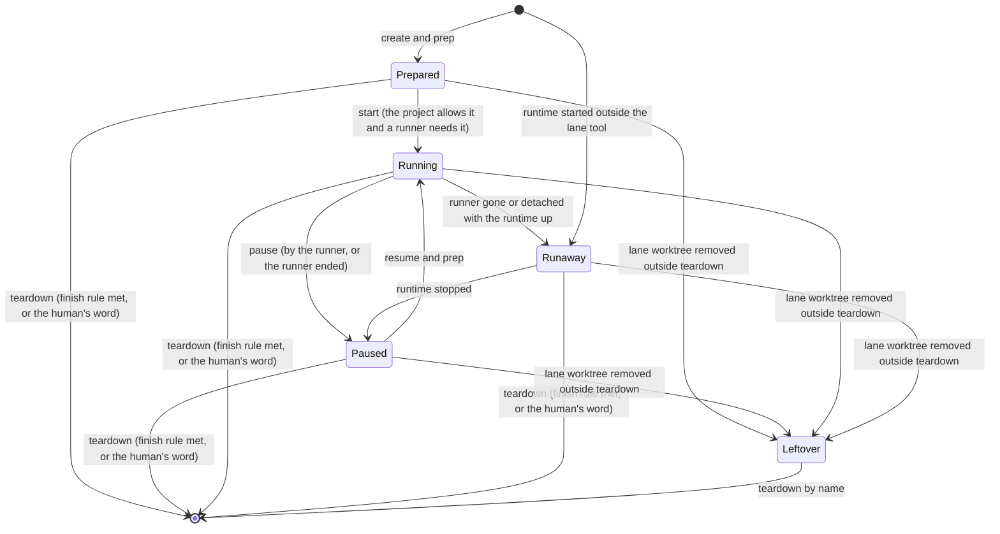

# The lane model

This is V3, started on 2026-10-06 from V2 as finished that day. It supersedes V2 (`2026-09-30-lane-model-v2.md`, in this directory), which supersedes V1 (`2026-09-29-lane-model-v1.md`, in this directory). It is meant to become the source of truth for lanes in every project that uses them. It says what a lane is and what must always hold. The model depends on no version control system and no agent harness. It describes the whole flow with only directories, a lane tool, and the people and scripts that use it. The model is an interface. It defines what every project must decide about its lanes (section 3), and decides none of it. Most projects use it with Git, a Git host and an agent harness, and each of them plugs in as an integration. Each project's workflow docs and lane tooling implement this model, and the project checks them against the model, never the other way round.

## Why lanes exist

Lanes have two purposes, and every rule below supports one of them.

**Isolation.** Several tasks, run by people or scripts, progress at the same time without touching each other's files, data or ports.

**Economy.** A lane's runtime runs only while its runner needs it. The rest of the time the lane is Paused or Prepared, and a Paused lane keeps what is costly to rebuild, so it resumes in seconds.

## 1. Terms

### The environment

- **Project.** A set of files that people develop together and that uses lanes. It has one main worktree, declares its lane settings (section 3) and has its own lane tool.
- **Lane tool.** The project's own commands that implement the lane operations (create, prep, start, pause, resume, stop a Runaway lane's runtime, take and leave the writer seat, list, teardown), and the registry they keep. The project chooses their names and how to invoke them.
- **Script.** Any program that runs lane operations with no person taking part, such as a scheduled job or a wrapper that serves a lane for someone to look at.
- **Dependencies.** Everything outside the project's files that the lane's runtime needs to start, such as a container engine, a database server or network access.
- **Integration.** A tool the model does not need but that projects usually use with it, such as a version control system or an agent harness. An integration binds the model's terms to its own objects, and may add terms, lane settings, transitions, checks and actors. It never relaxes an invariant.
- **Implementation.** What a project builds and writes to follow the model: its lane tool, its lane settings, its naming rule, its housekeeping limit, its workflow docs and its bindings. Wherever the model leaves a choice to the implementation, the project makes it there. The project checks the implementation against the model, never the other way round.
- **Binding.** The part of an implementation that says what plays each term of the model in the project: which command pauses a lane, what records the seats, which capabilities the environment offers. An integration brings its own binding for the terms it adds.

### The model

- **Main worktree.** The project's one canonical copy of its files, in a directory of its own. Finished work lands there. It hosts the lane tool and its registry, and housekeeping runs from it. Nobody works in it.
- **Brief.** The human's request for a piece of work, in their own words. Someone creates a lane from a brief and names the lane after it. What a brief contains and how the human gives it is outside the model.
- **Lane.** One unit of work: one task, one name, one lane worktree, and the runtime and data the task needs. A brief starts a lane and teardown ends it. Teardown waits for the finish rule unless the human says otherwise (I4).
- **Lane worktree.** The lane's own copy of the project's files. It is a directory that the lane tool creates from the main worktree and names after the lane. Every change of the lane happens there.
- **Starting point.** The state of the main worktree from which the lane tool created the lane worktree. The lane tool records it, so anyone can tell a lane's own changes apart from what landed in the main worktree afterwards. The implementation chooses how to record it.
- **Change.** Anything in a lane worktree that differs from its starting point.
- **Landed.** A change is landed when the main worktree holds it. How a change lands, who lands it and after which review is outside the model. The model only reads the result.
- **Lane name.** Whoever creates the lane chooses the name from the brief, so a person recognizes the task in it. The name is the lane's identity and never changes. The lane tool derives everything else the lane owns from the name (section 5). Names are unique. The project's naming rule (section 3) says which characters a name uses and how long it may be.
- **Runtime.** Everything that runs for the lane: application servers, background workers, local services, stubs, any other process.
- **Data.** Everything the lane stores outside its lane worktree: databases, object stores, working directories. The lane tool creates it at the lane's first start. Pause keeps it, and only teardown removes it.
- **Runner.** The person or script that a running lane's runtime belongs to. A person becomes a runner by starting the runtime by hand. The project says which kinds of runner its lanes allow. A runner may run several lanes. A lane has at most one runner, and only a Running lane has one.
- **Writer.** The person or script that is changing a lane's files. A lane has at most one writer at a time, and only the writer changes its files. A script that only runs the application is not a writer. The runner and the writer may be the same person or script, which then sits in both seats.
- **Seat.** A lane has two seats, runner and writer. For each seat the lane tool records who sits in it, since when, and whether they are still alive. The lane tool fills a seat when a runner or writer starts and empties it when they end. Every transition that could touch the lane reads both seats. The lane tool refuses whoever tries to take a taken seat, and what they do next is their own choice (section 7.1). A seat whose occupant is gone is stale. A person is never gone: they are the same person wherever they act from, and they leave a seat only by their own step (Pause, Writer ends). A script is gone when its process ends. The seats are not a worktree lock, which some tools keep only to stop someone from removing a worktree.
- **Reach.** Someone reaches a lane when they start to act on it: they run a step of the lane tool on it, or take one of its seats. Reading its files, listing lanes or comparing a lane with the main worktree does not reach it. An integration may name more of its own actions that reach a lane, such as a session starting in it. Whoever reaches a lane that runs under another runner or under none is warned first (section 7.1).
- **Prep.** What the lane tool does to make a lane worktree ready for work, right after create, on every resume and on any other trigger an integration adds. The model requires only the warning of section 7.1. The implementation and its integrations add the rest.
- **Pause.** Pause stops the runtime and keeps everything else.
- **Teardown.** Teardown removes the lane for good: its runtime, data, lane worktree and registry entries. It never removes anything in the main worktree.
- **Runaway.** The state of a lane whose lane worktree exists and whose runtime is up with no live runner. Either the runner is gone, or nobody recorded one, or someone detached the runtime from its runner on purpose. Runaway is a state name, used the same way as Paused.
- **Leftover.** A lane whose lane worktree is gone while some of its resources remain: data (an orphan), a runtime still up, a log file, a registry entry whose directory is gone. These are its remaining resources. Nothing brings a Leftover back. Teardown by name removes it with its remaining resources. A lane whose lane worktree exists is never a Leftover, even when it is Runaway or has a stale seat.
- **Housekeeping.** A procedure, not a service. It runs from the main worktree. It finds the lanes whose finish rule is met and tears them down with the same command a human would use. It finds the Runaway lanes and reports them. It reports every lane whose seats have both been empty for longer than the limit the project sets, and it reports everything else. The model defines what housekeeping does, not when it runs. Whoever uses the model chooses whether to run it by hand or on a schedule, and sets that schedule up.

## 2. Actors

| Actor | Does | Never does |
|---|---|---|
| Human | Writes the brief, creates lanes or has them created, may run or write in a lane, says when a lane is finished, authorises discarding work or ignoring a finish rule, decides when housekeeping runs | Skips a teardown check (I2). Discarding work or tearing down an unfinished lane takes the human's explicit word for that lane, never a default |
| Script | Runs lane operations with the same commands and the same refusals as a person, and is the runner of the runtimes it starts where the project allows it | Asks anyone, or gets past a refusal of the lane tool. What it does after a refusal is its own choice |
| Lane tool | Creates lane worktrees and records their starting points, records runners and writers, starts and pauses runtimes, lists lanes, Leftovers included, tears lanes down | Guesses when it cannot make a check (I9). Destroys anything before every check has passed (I2) |

## 3. Lane settings

The model is the interface every project implements. A project fills in the settings below once, for all its lanes, and keeps every rule in section 4. It never relaxes an invariant. The model fills in none of them. An integration may add settings of its own, and the project fills those in as well.

### Settings

| Setting | What the project decides |
|---|---|
| Runtime | Never, or on demand, when a runner needs the running application |
| Runners | Which kinds of runner may run a lane |
| Safe copy | Where a lane's changes must exist before teardown may remove them |
| Finish rule | What finishes a lane |

### Rules about the settings

The invariants of section 4 hold whatever values the project picks. These rules are about the settings themselves.

- The project declares its settings in a file inside the project, next to its code, so every copy of the project reads the same settings. The lane tool reads them from there. The model fixes neither the file's name nor its format.
- The project chooses the naming rule: which characters a lane name uses and how long it may be. The model fixes no format.
- A lane keeps the name it was created with. The model has no rename. A lane that should change its name becomes a new lane, and the old one finishes.
- A lane reads the settings as the project declares them now, and keeps no copy of the values it was created with. A change to the settings therefore reaches every lane, and the project checks the change against those lanes before it lands.
- A runtime runs until its runner pauses it or ends, and only its runner pauses it. A Runaway lane has no runner, so stopping its runtime takes it from nobody (section 7, Stop a Runaway lane's runtime). A runtime whose runner is a person can run forever if nobody checks. The lane list shows since when each runtime has run (I10), so anyone can check.

## 4. Invariants

These hold in every project, whatever the tooling.

- **I1. Work is never lost silently.** Nothing destroys irreplaceable work unless the work provably exists elsewhere or the human explicitly says to discard it. "Provably" means the safe copy holds it, checked at the moment of removal.
- **I2. Every refusal comes before any destruction.** Teardown evaluates all its checks first and then destroys. It never deletes data and then discovers it cannot remove the lane worktree. The human's word skips no check, and teardown still runs them all first.
- **I3. Only teardown removes a lane.** The lane tool refuses every other removal path that it can refuse. A removal it cannot refuse (a manual deletion, another tool's removal) leaves a Leftover, and the same teardown removes that Leftover with the same checks.
- **I4. A lane lives until its finish rule is met.** The project declares what finishes its lanes, and the teardown command enforces that rule itself. Nothing enforces a rule that exists only in the docs. Teardown removes a lane whose finish rule is not met only when the human explicitly says so for that lane, and that word does not also discard work (I1).
- **I5. Nothing runs without a reason.** A runtime starts only when the project allows it and its runner needs it, never by default and never "in case". It has exactly one recorded runner, and it stops when its runner pauses it or ends. A lane whose runtime is down is Paused or Prepared. A runner may run several lanes. When the runner ends, exactly those lanes pause, and nothing the runner does touches a lane another runner runs. A lane whose runtime is up while its runner is gone or was never recorded is Runaway. The list shows it as Runaway, and anyone may stop its runtime through the lane tool (section 7, Stop a Runaway lane's runtime). Nobody takes over a runtime while it runs. Whoever needs the application starts a new lane. A lane whose runtime someone detaches from its runner is Runaway from that moment.
- **I6. Identity is total and reversible.** Every resource id derives from the lane's name without collisions, and every remaining resource maps back to a lane name.
- **I7. The starting point is explicit.** The lane tool creates a lane worktree from the main worktree and records the state it started from. Nobody guesses anything about it later. Catching a lane up with changes that landed after it started is outside the model. An integration that adds it names the source of truth it reads, reads it on every run, and never loses a change.
- **I8. The main worktree is not a workspace.** It holds no work in progress. Every change, including changes to the lane tooling itself, happens in a lane. Enforcement covers every way of writing files. Where it is partial, the docs say which paths it does not cover. Read-only steps that run from the main worktree (listing lanes, comparing a lane with it) are not work.
- **I9. When the lane tool cannot make a check, nothing guesses.** A destructive operation refuses and a non-destructive one does nothing. Lane settings the lane tool cannot read are such a case.
- **I10. Every Leftover, each of its remaining resources and every anomaly of a living lane is visible and names its fix.** Listing lanes shows Runaway lanes, orphans, stale seats, registry entries whose directory is gone and stray files, each with the step that clears it. A running lane shows its runner and since when it has run, or says that no runner is recorded. When the list cannot see something (a dependency is down, no seats are recorded), it says so instead of showing nothing.
- **I11. Housekeeping has no more power than whoever runs it.** It uses the same commands with the same refusals, whether it runs by hand or from a schedule. It never gives the human's word. A lane that teardown refuses goes into the housekeeping report.
- **I12. One runner and one writer per lane, and stale seats are recoverable.** A lane has at most one runner and one writer at a time, and its seats say who they are. A runner may run several lanes. The lane tool can detect a seat whose runner or writer is gone. Stop a Runaway lane's runtime empties that seat, or whoever takes the seat next replaces it (Start runtime, Write). Start runtime replaces a stale runner seat only when the runtime is down. When the runtime is up the lane is Runaway, and Stop a Runaway lane's runtime empties the seat first. Both happen only after the lane tool has checked that no process of the old occupant remains. "End the runner first" is not an answer when the runner no longer exists.
- **I13. Teardown removes everything the lane owns.** Teardown removes every resource that create, prep or start made. When it cannot remove one (a dependency is down), it lists that resource as a remaining resource of the lane, which is then a Leftover. A change that adds a resource type to create or start adds it to teardown too.

## 5. What a lane owns

Every resource belongs to exactly one lane. The lane tool finds it from the lane name alone, or from a registry that the lane tool writes and reads. Resources fall into four kinds, and the kind decides which checks removal needs.

| Kind | Resources | Rule |
|---|---|---|
| Work (irreplaceable) | Changes in the lane worktree that are not in the safe copy | Destroyed only when the safe copy holds them or when the human says to discard them |
| State (costly to rebuild) | Databases, object stores, loaded or seeded data, assigned network ports, installed packages | Kept while the lane is paused, so resuming needs no rebuild. Only teardown destroys it |
| Runtime (costly to keep) | Processes: servers, workers, local services, stubs | Runs only while its runner needs it. Pause stops it, which is always safe because a process holds nothing of value |
| Disposable | Logs, generated configuration, caches, registry entries | Recreated on demand. Teardown removes them |

State is costly to rebuild and runtime is costly to keep. The Paused state keeps the state and stops the runtime.

Identity rules:

- The name gives the lane worktree's directory. Every resource id is a pure function of the name. Distinct lanes give distinct ids, even when a dependency shortens or rewrites the ids it receives.
- The reverse holds too. From any remaining resource (a data store, a process, a registry entry) the lane tool can name the lane it belonged to. Nobody can safely clean up a remaining resource that the lane tool cannot trace to a lane name, so it stays for good.
- The lane tool can trace every running process of a lane to its runner through the runner seat. A process that it can trace to the lane but not to a runner makes the lane Runaway.

## 6. States

- **Prepared.** The lane worktree exists, created from the main worktree. The lane has no runtime and no data. This is enough for changes that do not need the running application, and it is the only state of a lane that never needs it.
- **Running.** The runtime is up, and the data exists since the first start. Exactly one recorded runner, of a kind the project allows, runs the lane until that runner pauses it or ends. A runner may run several Running lanes. A lane whose runtime has no runner is Runaway, not Running. A lane becomes Running only through Start runtime (section 7).
- **Runaway.** The lane worktree exists and the runtime is up with no live runner. The runner is gone, or nobody recorded one, as when someone starts a runtime outside the lane tool or detaches it from its runner. A Prepared or Paused lane whose runtime starts that way is Runaway too. Runaway is an anomaly of a lane that still lives, so it is not a Leftover. Nobody takes over the runtime while it runs. Someone stops it (section 7, Stop a Runaway lane's runtime), the lane is Paused, and whoever needs the application starts a new lane.
- **Paused.** The runtime is stopped. The lane keeps its data, port, installed packages and lane worktree. Every lane that has run and is not running is Paused, for example between two stretches of work or while its changes wait to land. Resuming from here takes seconds, not a rebuild. When someone stops a Runaway lane's runtime before the lane's first start through the lane tool, the lane is Paused with no data yet, and the lane tool creates the data at that first start.
- **Finished is not a state.** It is a property of any living lane: the finish rule is met. The lane tool reads the rule when asked and stores no result, since a rule can change its answer (a closed pull request can reopen). A lane whose rule is met stays in its state. A Running one is paused by its runner as usual, and teardown then removes it. The list shows the rule's result beside the state.
- **Leftover.** The lane worktree is gone and something of the lane remains: data, registry entries, a runtime still up. A Leftover is always an anomaly. The list must show it, and nothing brings it back. Teardown by name is the only operation that ends it.
- **Absent.** Nothing of the lane remains.

Only a running runtime has a runner, and only active editing has a writer. No transition of the model removes irreplaceable work without a check, and a removal outside teardown that nothing can refuse leaves a Leftover (I3). Outside the two anomalies, Runaway and Leftover, a lane has a runtime only while Running.

## 7. Transitions

Each row of the first table is one edge of the diagram in section 6, from one state to another. A row that names several states under From stands for the edges that leave each of them and differ in nothing else. Each transition has one trigger, one owner and a fixed set of checks. A new mechanism (a hook, a flag, a housekeeping step, an integration) either implements one of the rows of this section or adds a row here first, and a row that adds an edge adds it to the diagram too. Where a trigger or a check depends on a lane setting, the row says so and the project's settings give the value.

| Transition | From | To | Trigger | Owner | Checks before acting | When a check fails |
|---|---|---|---|---|---|---|
| Create | Absent | Prepared | A human brief asks for a lane | The human, or whoever acts on the brief, through the lane tool | The name follows the project's naming rule and is unique. The lane tool creates the lane worktree from the main worktree and records its starting point. Prep follows (below) | Stop and ask |
| Start runtime | Prepared | Running | The project allows a runtime and a runner needs it, and not before | Lane tool, for the runner | Dependencies are available. The project allows this kind of runner. No other runner runs the lane. This runner takes the runner seat, and replaces a stale one once the lane tool has shown that its runner is gone (I12). On the lane's first start, the lane tool creates its data once these checks pass | Missing dependencies: stop and ask the human to provide them, and never install or start them unasked. Another runner: refuse and show the seats (section 7.1). A Runaway lane: refuse and say so. Someone stops its runtime first (Stop a Runaway lane's runtime), and then the runner starts it |
| Pause | Running | Paused | The runner asks, or the runner ends cleanly, as when a script exits | Lane tool, for the runner | The runner that pauses the lane is the one that runs it. A runner that ends pauses every lane it runs, and no other lane | Leave it running and say so |
| Resume | Paused | Running | Someone needs the lane again | Lane tool | Prep (below), then the checks of Start runtime | Same as prep and Start runtime |
| Runner gone | Running | Runaway | The runner crashes, or someone detaches the runtime from its runner | Nobody on a crash. Whoever detaches the runtime | None, since nothing can refuse it. On a crash the runner seat goes stale. The list shows the lane as Runaway (I5, I10, I12) | None |
| Runtime started outside the lane tool | None. It enters the flow from outside, as Create does | Runaway | Someone starts the lane's runtime outside the lane tool | Whoever starts it | None, since nobody asks the lane tool. It records no runner, traces the process to the lane (section 5), and the list shows the lane as Runaway (I10) | None |
| Stop a Runaway lane's runtime | Runaway | Paused | Someone finds a Runaway lane | Whoever finds it, through the lane tool | The lane worktree exists. The runner seat records nobody, or the recorded runner is gone and no process of it remains (I12). The lane tool stops the runtime and empties the stale runner seat | Leave the lane as it is and say so (I9). A lane whose lane worktree is gone is a Leftover, and only teardown by name ends it |
| Teardown | Prepared, Paused, Running or Runaway. When the finish rule is not met, only on the human's explicit word (I4) | Absent | The finish rule is met, or the human asks | Whoever runs housekeeping, or the human, all through one command | In this order, all before teardown destroys anything: no live runner or writer sits in a seat, the safe copy holds every change in the lane worktree, and the finish rule is met | Refuse, touch nothing, name the reason, and say whether the human's word can lift the refusal. The human's word cannot lift a refusal caused by a live runner or writer in a seat |
| Lane worktree removed outside teardown | Prepared, Paused, Running or Runaway | Leftover | A manual deletion, or another tool's removal | Anyone | Whatever can refuse the removal refuses it (I3). When nothing refuses it, the lane is a Leftover and the next list shows it (I10) | The removal does not happen, and the lane stays in its state |
| Teardown by name | Leftover | Absent | Someone finds the Leftover in the list | Same as Teardown | The checks of Teardown, against whatever of the lane is left | Same as Teardown. Nothing else ends a Leftover |

Three steps are not edges, because none changes the lane's state.

**Finish** is a predicate, not a transition (section 6). Whoever the finish rule names makes it true, and the lane tool reads it live whenever a check needs it.

**Prep** is a step, not a transition of its own. It runs right after Create and as the first step of Resume, and an integration may add triggers, such as the start of a session in the lane. The lane tool checks that the lane is not running under another runner or under none. When it is, the lane tool warns, shows the seats and goes on (section 7.1).

**Land** is outside the model (section 1, Landed). Whoever the project's review process allows lands a change, and the model sets no check on it.

The writer seat changes while the lane stays in its state, so its changes have a table of their own. The runner seat changes only with the state: Start runtime and Resume fill it, Pause empties it, Runner gone leaves it stale on a crash, and Stop a Runaway lane's runtime empties a stale one.

| Seat change | From | To | Trigger | Owner | Checks before acting | When a check fails |
|---|---|---|---|---|---|---|
| Write | Writer seat empty or stale | Writer seat taken | Someone starts changing the lane's files | The writer | When the lane runs under another runner or under none, the lane tool warns first and goes on (section 7.1). The lane has no other live writer. This writer takes the writer seat, and replaces a stale one once the lane tool has shown that its writer is gone (I12) | Refuse and show the seats (section 7.1) |
| Writer ends | Writer seat taken | Writer seat empty | The writer stops changing the lane's files | The writer, through the lane tool | None. The lane tool empties the writer seat | None |
| Writer gone | Writer seat taken | Writer seat stale | The writer crashes | Nobody | None, since nothing can refuse it. The seat shows as stale in the list (I10, I12), and the next writer replaces it (Write) | None |

### 7.1 Meeting a running lane

A person, a script or the lane tool may reach a lane (section 1, Reach) that runs under another runner, or under no runner at all. The lane tool warns whoever reaches the lane before they do anything there. The warning is therefore part of every step that reaches a lane, whatever its trigger: prep, Write, and every action an integration names. A step that refuses and shows the seats, such as Start runtime under another runner, has given the warning.

The warning shows the seats: who runs the runtime, by script name or as a person who started it by hand, when it started, whether that runner is still alive, and who sits in the writer seat. When the seats record nobody, the warning says so and says the lane is Runaway. When the environment keeps no records at all, the warning says that instead. It also says which step will refuse the person or script next, such as Start runtime on a lane that runs under another runner.

A taken seat stays with whoever sits in it. The lane tool refuses whoever tries to take it and shows the seats again. What the refused person or script does next, such as making the change in another lane, is their own choice and outside the model.

No step of the model hands the runtime or the writer seat to someone else. A change of writer is two rows of section 7 in order. The old writer ends (Writer ends), then the new one takes the empty writer seat (Write). No implementation hands over the runtime. A new runner starts it only after the old runner has paused it, or after someone has stopped the runtime of a Runaway lane.

A Runaway lane has no live runner, so stopping its runtime takes it from nobody. Anyone may stop it through the lane tool (section 7, Stop a Runaway lane's runtime). Nobody takes the runner seat while the runtime is up. Whoever needs the application starts a new lane once it is stopped (I5).
